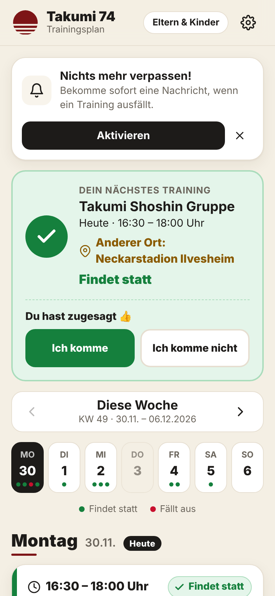
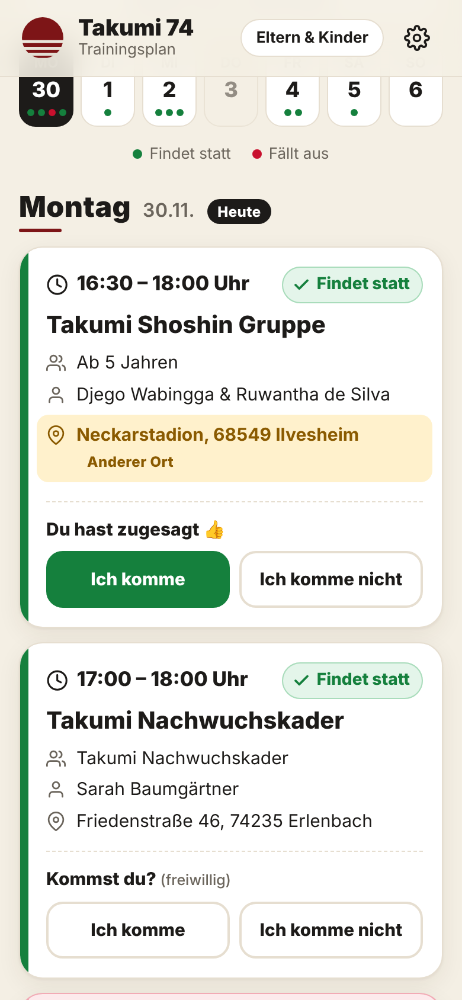
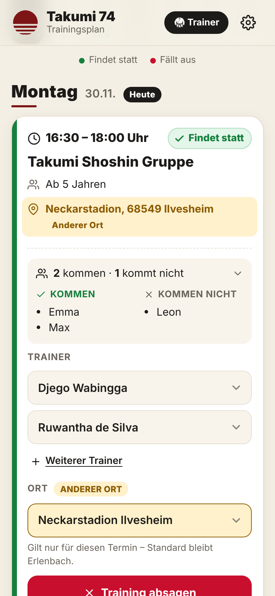

# Trainingsplan Takumi 74

Eine einfache App für den Trainingsplan von **Takumi 74**. Fällt ein Training aus, bekommen Eltern und Kinder sofort eine Push-Nachricht. Bisher lief das nur über den WhatsApp-Chat.

Die App läuft auf **Android und iPhone** als Web-App. Man verteilt einfach einen Link und legt die App auf den Home-Bildschirm, ein App Store ist nicht nötig.

➡️ **Veröffentlichen auf Cloudflare:** siehe [ANLEITUNG-CLOUDFLARE.md](ANLEITUNG-CLOUDFLARE.md)

| Eltern & Kinder | Zu-/Absagen | Trainer-Ansicht | Training absagen |
|---|---|---|---|
|  |  |  |  |

## Funktionen

### Für Eltern & Kinder
- Feld **„Dein nächstes Training“**: Man sieht sofort, ob es stattfindet (grün ✓) oder ausfällt (rot ✕).
- **Push-Nachricht nur bei Ausfall**. Sie lässt sich in den Einstellungen per Schalter ein- und ausschalten.
- **Zu-/Absagen** mit „Ich komme / Ich komme nicht“ bei jedem Training. Das ist freiwillig und jederzeit änderbar, den Namen sehen nur die Trainer.
- **Meine Gruppen**: Auf Wunsch werden nur die eigenen Trainings angezeigt und gemeldet.
- **Vergangene Trainings werden ausgeblendet.** Beim Öffnen sieht man immer, was als Nächstes kommt.
- Ein **anderer Ort** (z. B. Neckarstadion Ilvesheim) ist farbig markiert. Ein Tipp auf die Adresse öffnet Google Maps.

### Für Trainer (gemeinsame PIN)
- **Training absagen** mit optionalem Grund. Eltern & Kinder bekommen sofort eine Push-Nachricht. „Findet doch statt“ nimmt die Absage zurück, ohne Push.
- **Trainer per Auswahlfeld ändern**: nur für diesen Termin (Vertretung) oder jede Woche.
- **Ort per Auswahlfeld ändern**, nur für diesen Termin. Standard bleibt immer Erlenbach.
- **Rückmeldungen** pro Training: wer kommt und wer nicht.
- **Einstellungen:** Trainer anlegen, umbenennen und entfernen (mit Nachfolger), Trainer-PIN ändern.

### Trainingsplan
| Tag | Training | Zeit | Trainer |
|---|---|---|---|
| Montag | Takumi Shoshin Gruppe (ab 5 J.) | 16:30–18:00 | Djego Wabingga & Ruwantha de Silva |
| Montag | Takumi Nachwuchskader | 17:00–18:00 | Sarah Baumgärtner |
| Montag | Takumi Wettkampfkader 1 | 18:00–19:30 | Lena Staiger |
| Montag | Takumi Wettkampfkader 2 | 19:00–20:30 | Lena Staiger |
| Dienstag | Erwachsenentraining | 18:00–19:15 | Ruwantha de Silva |
| Mittwoch | Takumi Nachwuchskader | 16:00–17:30 | Lena Staiger |
| Mittwoch | Takumi Wettkampfkader | 17:00–19:00 | Lena Staiger |
| Mittwoch | Takumi Athletikgruppe (Talstraße 40) | 19:15–20:15 | Florian Staiger |
| Freitag | KVBW Landesstützpunkt | 17:00–19:00 | Lena Staiger |
| Freitag | Takumi Teamtraining | 19:00–20:00 | Lena Staiger |
| Wochenende | Wettkampftraining | nach Vereinbarung | Lena Staiger |

Ort ist, wenn nicht anders angegeben, Friedenstraße 46, 74235 Erlenbach. Der Plan steht in [`js/data.js`](js/data.js). Neue Trainings dort eintragen, sie erscheinen nach dem nächsten Deploy automatisch.

## Aufbau

```
index.html, css/, js/, icons/, sw.js, manifest.webmanifest   → die App (läuft im Browser, installierbar)
server/src/index.js     → Cloudflare Worker: API unter /api/, Push-Versand, tägliches Aufräumen
server/src/setup.js     → richtet Datenbank, Startdaten und Push-Schlüssel beim ersten Start selbst ein
server/src/webpush.js   → Web-Push (VAPID, aes128gcm) ohne externe Bibliotheken
server/test/            → Server-Tests (npm test)
wrangler.toml           → Cloudflare-Konfiguration
```

- **Server-Modus** (auf Cloudflare): Die Daten liegen in einer D1-Datenbank und gelten für alle. Die Trainer-PIN wird auf dem Server geprüft, mit Schutz gegen Raten.
- **Demo-Modus** (ohne Server, z. B. GitHub Pages oder `python3 -m http.server`): Alles bleibt auf dem Gerät. Demo-PIN `7474`.

Die App erkennt den Modus selbst.

## Entwickeln

```bash
npm install
npm run dev      # lokaler Server mit Datenbank: http://localhost:8787 (PIN aus .dev.vars: TRAINER_PIN=…)
npm test         # Server-Tests
npm run deploy   # auf Cloudflare veröffentlichen (vorher: npx wrangler login)
```

Für `npm run dev` eine Datei `.dev.vars` mit `TRAINER_PIN=1234` anlegen. Sie wird nicht eingecheckt.

## API (Kurzüberblick)

| Methode | Pfad | Zweck |
|---|---|---|
| GET | `/api/health` | Einrichtung prüfen |
| GET | `/api/state` | Trainer, Trainings, Orte, Ausnahmen |
| POST | `/api/login` | Trainer-Anmeldung mit PIN |
| POST / DELETE | `/api/occurrences/{key}/cancel` | Absagen (mit Push) / zurücknehmen |
| PUT / DELETE | `/api/occurrences/{key}/trainers` | Vertretung oder dauerhafter Wechsel |
| PUT / DELETE | `/api/occurrences/{key}/location` | Ort für einen Termin |
| PUT | `/api/rsvp` | Zu-/Absage eines Geräts |
| GET | `/api/rsvps` | Rückmeldungen (nur Trainer) |
| POST | `/api/push/subscribe` | Gerät für Push anmelden |

`{key}` = `<trainingId>@<YYYY-MM-DD>`, z. B. `mo-shoshin@2026-11-30`.
