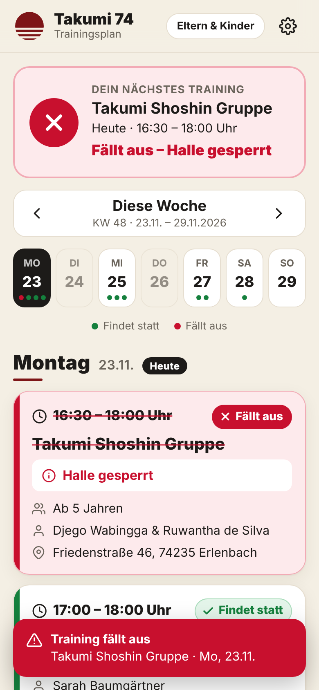
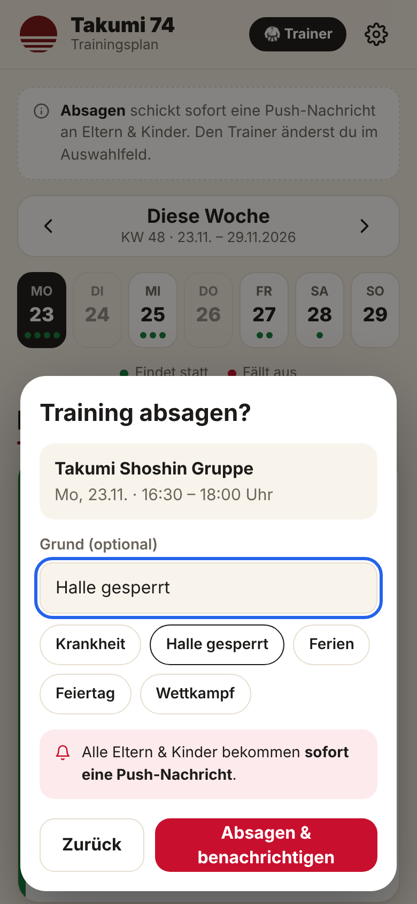

# Trainingsplan Takumi 74

Eine einfache App für den Trainingsplan von **Takumi 74**. Fällt ein Training aus, bekommen Eltern und Kinder sofort eine Push-Nachricht. Bisher lief das nur über den WhatsApp-Chat.

> **Status: Prototyp zum Präsentieren.** Die App läuft komplett im Browser und speichert alles lokal auf dem Gerät. Für echte Push-Nachrichten an alle Eltern wird noch ein Server angebunden (siehe [Nächste Schritte](#nächste-schritte-server)).

| Eltern & Kinder | Push bei Ausfall | Trainer-Zugang | Training absagen |
|---|---|---|---|
|  |  |  |  |

## Funktionen

### Zwei Zugänge
- **Eltern & Kinder** sehen den Plan nur an und werden benachrichtigt.
  - Großes Feld **„Dein nächstes Training“**: Auf einen Blick sieht man, ob es stattfindet (grün ✓) oder ausfällt (rot ✕).
  - Optional nur die **eigenen Gruppen** anzeigen, z. B. nur „Takumi Shoshin Gruppe“.
- **Trainer** (mit PIN geschützt, Demo-PIN `7474`)
  - **Training absagen** mit optionalem Grund (Schnellauswahl: Krankheit, Halle gesperrt, Ferien …). Eltern & Kinder bekommen **sofort eine Push-Nachricht**.
  - **Trainer per Auswahlfeld ändern**, entweder *nur für diesen Termin* (Vertretung) oder *jede Woche* (dauerhafter Wechsel). Auch mehrere Trainer pro Training sind möglich (wie bei der Shoshin Gruppe).
  - Eine Absage lässt sich mit **„Findet doch statt“** zurücknehmen. Dabei wird bewusst keine Push-Nachricht verschickt.
  - **Einstellungen:** neue Trainer anlegen, umbenennen, entfernen (mit Auswahl, wer die Trainings übernimmt) und die PIN ändern.

### Kalender
- Der Trainingsplan aus dem PDF ist hinterlegt und gilt automatisch für **jede Woche** mit echtem Datum (KW, Wochentage, „Heute“).
- Mit den Pfeilen blättert man zwischen den Wochen. Eine Absage gilt nur für den einen Termin.
- **Farben:** grün = findet statt, rot (durchgestrichen) = fällt aus, blass = vorbei.
- Ein Tipp auf die Adresse öffnet Google Maps.

### Push-Nachrichten
- **Nur bei einem Ausfall.** Ein Trainerwechsel oder das Zurücknehmen einer Absage löst keine Nachricht aus.
- Inhalt, z. B.:
  > ❌ **Training fällt aus**
  > Takumi Shoshin Gruppe
  > Mo, 23.11. · 16:30 – 18:00 Uhr
  > Grund: Halle gesperrt

### Gemacht für Handy und Kinder
- Große Schrift und Tippflächen, klare Farben mit Symbolen (✓ / ✕) statt nur Farbe.
- Als **App installierbar** (PWA): auf dem Startbildschirm, ohne App Store.
- Heller und dunkler Modus. Auf dem Laptop oder Beamer stehen die Tage nebeneinander wie im PDF.

## Demo starten

Die App braucht keinen Build-Schritt. Es reicht ein einfacher Webserver im Projektordner:

```bash
python3 -m http.server 8080
# oder
npx serve .
```

Danach im Browser **http://localhost:8080** öffnen.

> Wichtig: Die Datei `index.html` nicht direkt per Doppelklick öffnen (`file://`). Service Worker und Benachrichtigungen funktionieren nur über `http://localhost` oder `https://`.

### Tipps für die Präsentation
1. **Zwei Fenster nebeneinander** öffnen (gleicher Browser): links „Eltern & Kinder“, rechts „Trainer“ (Einstellungen → Zum Trainer-Zugang, PIN `7474`).
2. Im Eltern-Fenster auf **„Aktivieren“** tippen und Benachrichtigungen erlauben.
3. Im Trainer-Fenster ein Training **absagen**. Im Eltern-Fenster wird es sofort rot, und eine echte System-Benachrichtigung erscheint.
4. Danach kann man über **Einstellungen → Demo-Daten zurücksetzen** wieder von vorne anfangen.

Auf dem Handy zeigen: Die App auf einen Server mit HTTPS legen (z. B. GitHub Pages, Netlify, Vercel). Dann im Browser öffnen und **„Zum Home-Bildschirm“** wählen.
Hinweis zum iPhone: Push-Nachrichten gibt es ab iOS 16.4, und nur wenn die App über „Zum Home-Bildschirm“ installiert wurde.

## Projektstruktur

```
index.html              Einstiegsseite
manifest.webmanifest    App-Infos für die Installation (Name, Icons, Farben)
sw.js                   Service Worker: offline nutzbar + empfängt Push-Nachrichten
css/styles.css          Gestaltung (hell/dunkel, mobil zuerst)
js/
  app.js                Ansichten & Bedienung
  data.js               Trainingsplan & Trainer aus dem PDF
  schedule.js           Wöchentlicher Plan → konkrete Termine im Kalender
  store.js              Datenhaltung (jetzt lokal, später Server)
  notify.js             Benachrichtigungen & Push-Anmeldung
  config.js             Server-Adresse, Push-Schlüssel, Demo-PIN
  dates.js, icons.js    Hilfsfunktionen, Icons & Logo
icons/                  App-Icons
docs/screenshots/       Screenshots
```

### Datenmodell
- **Trainer:** `{ id, name }`
- **Trainings (wöchentlich):** `{ id, weekday, title, audience, start, end, location, trainerIds }`
- **Ausnahmen pro Termin:** Schlüssel `"<trainingId>@<YYYY-MM-DD>"`, z. B. `mo-shoshin@2026-11-23`, mit `{ canceled, reason, trainerIds }`
- **Ereignisse:** Liste der Absagen. Daraus entstehen die Push-Nachrichten.

Den Plan ändern (z. B. neue Zeiten oder ein neues Training): `js/data.js` anpassen und unter Einstellungen „Demo-Daten zurücksetzen“ wählen.

## Nächste Schritte (Server)

Alle Stellen, die ein Server später übernimmt, sind im Code mit `SERVER:` markiert (vor allem in `js/store.js`). Die Oberfläche bleibt dabei unverändert.

1. **API** (Vorschlag):
   | Methode | Pfad | Zweck |
   |---|---|---|
   | `GET` | `/api/schedule` | Trainer, Trainings und Ausnahmen laden |
   | `POST` | `/api/occurrences/{key}/cancel` | Training absagen (`{ reason }`) → **Server verschickt Push** |
   | `DELETE` | `/api/occurrences/{key}/cancel` | Absage zurücknehmen |
   | `PUT` | `/api/occurrences/{key}/trainers` | Vertretung für einen Termin |
   | `PUT` | `/api/sessions/{id}/trainers` | Trainer dauerhaft ändern |
   | `POST/PATCH/DELETE` | `/api/trainers` | Trainer verwalten |
   | `POST` | `/api/push/subscribe` | Gerät für Push anmelden (`{ subscription, groups }`) |
2. **Web-Push:** Mit einem VAPID-Schlüsselpaar arbeiten (z. B. Node-Paket `web-push`). Den öffentlichen Schlüssel in `js/config.js` → `vapidPublicKey` eintragen. Der Service Worker (`sw.js`) zeigt eingehende Nachrichten an, auch wenn die App geschlossen ist. Erwartetes Format: `{ "title", "body", "tag", "url" }`.
3. **Trainer-Login** auf dem Server prüfen, z. B. mit eigenen Zugängen pro Trainer statt einer gemeinsamen PIN.
4. **Live-Aktualisierung**, wenn die App offen ist: neu laden beim Öffnen, optional per Server-Sent Events oder WebSocket.
5. **Hosting mit HTTPS.** Das ist Pflicht für Push und für die Installation als App.
